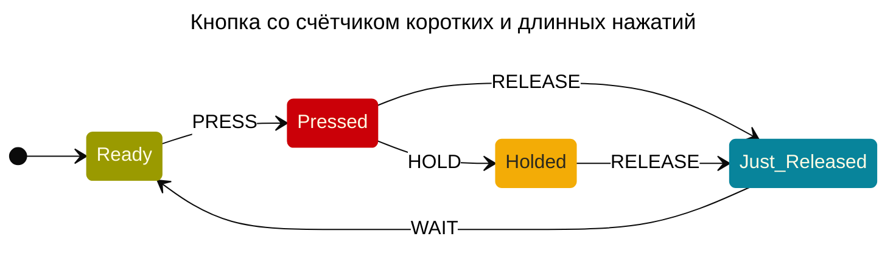

# https://sketch.stately.ai

# uv :: https://docs.astral.sh/uv/getting-started/installation/#standalone-installer

## https://astral.sh/uv/install.sh

# https://github.com/vgmakeev/xstate-mermaid/tree/main

    $ uvx --from "git+https://github.com/vgmakeev/xstate-mermaid.git" xstate-dsl mermaid2xstate mermaid.md -o xstate.json